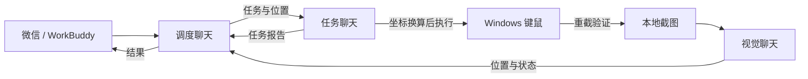

# Legion WorkBuddy Computer Use

面向**联想拯救者（Lenovo Legion）Windows 笔记本**的 WorkBuddy 桌面操作项目。WorkBuddy 看截图、找目标，本地工具换算坐标并操作鼠标和键盘，操作完成后重新截图核对结果。

| 首发环境 | 当前范围 |
| --- | --- |
| 笔记本 | 拯救者 Y9000P IRX8（82WK） |
| 系统 | Windows 11 x64，首发开发机为 22H2，内部版本 22621 |
| Python | 3.13 x64，开发验证使用 3.13.5 |
| WorkBuddy | Windows 桌面客户端，历史接入记录来自 37.10.3-43 环境 |

本项目只维护联想拯救者笔记本的兼容性。其他拯救者型号请先按安装指南验证截图和坐标。

## 它能做什么

- **看屏幕、找位置。** 本地截图交给 WorkBuddy 视觉聊天。坐标使用截图尺寸和原点换算，可处理缩放预览和局部截图。
- **让三个聊天协作。** 调度聊天派发、视觉聊天识别、任务聊天执行和回报。一次只给一个活动任务键鼠控制权。
- **控制截图留存。** 启动后立即截图，之后约每 15 秒抓取一张。每 300 秒清理本轮可回收截图，保留排队和分析中的图片。结束本轮时清理该轮登记的截图。
- **从微信查看结果。** WorkBuddy 的微信入口可用于下达任务和接收结果，订阅通知由 WorkBuddy 提供。详见[微信接入](docs/wechat.md)。



## 开始使用

1. 按[安装指南](docs/install.md)准备 Python，添加两个 MCP 服务。
2. 按[三聊天工作流](docs/workflow.md)完成一次只读派发和回报，然后试一次移动光标。
3. 需要手机操作时，按[微信接入](docs/wechat.md)绑定自己的 WorkBuddy 并验收通知。

`vision-server/` 提供 **desktop-coordinator**，管理角色、消息、截图、坐标和清理。`computer-control-server/` 提供 **computer-control**，执行 Windows 键鼠动作。视觉识别由 WorkBuddy 承担，源码没有单独的豆包、ARK 或其他模型 API 调用。

本地协调端点仅监听回环地址。聊天 ID 用于协作角色检查。只把服务配给自己信任的 WorkBuddy 工作区。屏幕图像会传给执行识别的 WorkBuddy 会话，请先关闭含有敏感内容的窗口。

## 验证

在源码目录运行以下命令。单元测试使用模拟截图，覆盖坐标、任务隔离、计时与本轮清理。

```powershell
.\.venv\Scripts\python.exe -m unittest discover -s tests -v
```

另有 `tests/live_mcp_check.py`，它在隔离的测试状态中启动三个 MCP 进程并截取真实桌面，验证截图、坐标和清理。请准备好可用于测试的桌面，再按[安装指南](docs/install.md#本地验证)执行。

这是个人项目。WorkBuddy、微信和 Lenovo Legion 分别归属其权利方。
